  <picture><source media="(max-width: 767px)" srcset="assets/readme/banner-m.svg"></picture>

  
  

Oracle Cloud's Always Free Ampere VMs are often "out of host capacity", and clicking Create by hand until one appears can take days. This repository lets GitHub do the waiting. Every hour, an Action retries the launch for about 54 minutes. When Oracle finally has room, it opens an issue (so GitHub e-mails you) and switches itself off.

No credentials, OCIDs or IP addresses are stored in the repository or printed in the logs.

## How it works

  <picture><source media="(max-width: 767px)" srcset="assets/readme/how-it-works-m.svg"></picture>

| File | What it does |
|---|---|
| [`grab.sh`](grab.sh) | One retry window. Reuses an existing public subnet, picks the newest Ubuntu 24.04 aarch64 image and launches `VM.Standard.A1.Flex` (1 OCPU, 6 GB) named `cti-verify`. Waits 50 to 90 seconds between attempts. Exits early if that VM already exists. |
| [`.github/workflows/grab.yml`](.github/workflows/grab.yml) | Runs at minute 3 of every hour (or by hand with a custom window), installs the OCI CLI, writes credentials from secrets, runs `grab.sh`, then opens an issue and disables itself on success. |

Each run writes a one-line summary: still waiting (with the number of attempts), VM created, or the VM already exists.

## Architecture

  <picture><source media="(max-width: 767px)" srcset="assets/readme/architecture-m.svg"></picture>

## Use it for your own tenancy

1. Fork the repository.
2. Add these encrypted secrets under **Settings › Secrets and variables › Actions**:

   | Secret | Value |
   |---|---|
   | `OCI_USER` | your user OCID |
   | `OCI_FINGERPRINT` | the API key's fingerprint |
   | `OCI_TENANCY` | your tenancy OCID |
   | `OCI_REGION` | for example `ap-mumbai-1` |
   | `OCI_KEY_PEM` | the API private key, PEM text |
   | `SSH_PUBLIC_KEY` | the public key to put on the VM |

3. Open the **Actions** tab and enable workflows. Start one run by hand to check the credentials; the hourly schedule takes over from there.

Your tenancy needs a public subnet already; `grab.sh` reuses one and stops with a message if there is none.

To change the VM, add `VM_NAME`, `OCPUS` or `MEMORY_GB` to the `env:` of the "Try to launch the VM" step (defaults: `cti-verify`, 1, 6).

## License

No license file has been added yet, so default copyright applies.

  <a href="https://github.com/JustKamlesH21"><picture><source media="(max-width: 767px)" srcset="assets/readme/footer-m.svg"></picture></a>

